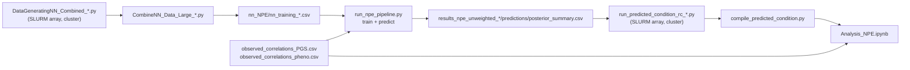

# PGS_Cor_Relative

Simulation-based inference for the correlations of polygenic scores (PGS) and phenotypes between
relatives, including distant in-law relatives (spouses, siblings-in-law, a spouse's sibling's
spouse, …). Several generative models of assortative mating, vertical transmission and
migration are simulated forward in time. A neural posterior estimator (NPE) is trained on the
simulated correlations and applied to the observed educational-attainment (EA) correlations.
Each model is then simulated again at its estimated parameters (the *predicted condition*) and
compared with the observed data.

## Contents

- [Pipeline at a glance](#pipeline-at-a-glance)
- [Repository layout](#repository-layout)
- [1. Simulation model](#1-simulation-model)
- [2. Relatives and summary statistics](#2-relatives-and-summary-statistics)
- [3. Conditions](#3-conditions)
- [4. Generating training data](#4-generating-training-data)
- [5. Neural posterior estimation](#5-neural-posterior-estimation)
- [6. Predicted conditions](#6-predicted-conditions)
- [7. Analysis notebook](#7-analysis-notebook)
- [8. Caveats and known issues](#8-caveats-and-known-issues)
- [SimulationFunctions dependency (git submodule)](#simulationfunctions-dependency-git-submodule)
- [Maintenance scripts](#maintenance-scripts)

## Pipeline at a glance



1. **Simulate training data.** For each condition, simulate thousands of populations with
   parameters drawn uniformly from a box, and record PGS and phenotypic correlations between 16
   kinds of relatives ([§4](#4-generating-training-data)).
2. **Fit.** Train an NPE on the simulated (parameters, correlations) pairs and condition it on the
   observed correlations. This gives a posterior over each model's parameters
   ([§5](#5-neural-posterior-estimation)).
3. **Predicted conditions.** Simulate each model at its posterior estimates (100 replicates), so
   the correlations it implies can be compared with the observed ones
   ([§6](#6-predicted-conditions)).
4. **Compare** in `Scripts/nn_NPE/Analysis_NPE.ipynb` ([§7](#7-analysis-notebook)).

## Repository layout

```
Scripts/
├── SimulationFunctions/         simulation engine (git submodule, GeneEvolve-Python)
│   ├── core_simulation.py       AssortativeMatingSimulation
│   ├── island_migration.py      IslandMigrationSimulation (subclass)
│   ├── relationship_finder.py   relative pairs from a pedigree path ("MSC", "PSC", …)
│   └── postprocessing.py        individual measures, pair correlations
├── run_rc_paper/                cluster scripts (CURC, SLURM)
│   ├── DataGeneratingNN_Combined_<cond>.py       training-data generator (one per condition)
│   ├── CombineNN_Data_Large_<cond>.py            merge per-condition outputs into one CSV
│   ├── submit_datagenerating_nn_combined_<cond>.sh
│   ├── run_predicted_condition_rc_<cond>.py      predicted-condition simulation
│   ├── submit_predicted_condition_<cond>.sh
│   ├── submit_all_predicted_conditions.sh        submit the predicted conditions of 01–04
│   ├── compile_predicted_condition.py            per-task outputs -> summary_statistics.csv
│   └── check_predicted_conditions.py             scripts vs NPE fits vs generators
├── run_rc_paper_wider/          training data for 01–04 with wider parameter ranges (§4.1)
│   ├── DataGeneratingNN_Combined_<cond>_wider.py
│   ├── submit_datagenerating_nn_combined_<cond>_wider.sh
│   ├── CombineNN_Data_Large_wider.py / submit_combine_nn_wider.sh   one script for all four
│   └── submit_all_wider.sh                        submit every array + its combine job
├── nn_NPE/                      model fitting (local)
│   ├── nn_training_<cond>.csv                    training data (not in git)
│   ├── observed_correlations_PGS.csv / _pheno.csv
│   ├── observed_correlations_PGS_ea4new.csv      PGS correlations with the updated EA4 PGS
│   ├── make_observed_ea4new.py                   ea4_new_old.csv -> the file above
│   ├── run_specs/<fit>/{features,params}.txt     what each fit uses and estimates
│   ├── run_npe_pipeline.py                       train + predict every fit
│   ├── train_npe_pgs_and_pheno.py                NPE training
│   ├── predict_npe_pgs_and_pheno.py              posterior for the observed data
│   ├── npe_count.py                              posterior with an integer parameter (n_gen)
│   ├── results_npe_unweighted_<fit>/             fitted model + predictions/ (not in git)
│   ├── results_archive/                          earlier fits, moved here by the pipeline
│   └── Analysis_NPE.ipynb                        predicted vs observed correlations
├── test_04EAmigration/          identifiability tests and NPE benchmarks for condition 04
└── Archive/                     retired conditions and unrun generator designs
```

## 1. Simulation model

The engine (`Scripts/SimulationFunctions/core_simulation.py`) simulates two traits $t = 1, 2$ in
a population of $N$ individuals (40,000 in every condition) over discrete, non-overlapping
generations. Trait 1 is always EA. Trait 2 is either a second trait, a latent mating or
migration factor, or an inert placeholder, depending on the condition.

### 1.1 Genotypes and genetic effects

There are $M$ biallelic causal variants ($M = 1000$). Their allele frequencies are
$p_j \sim \mathrm{U}(0.01, 0.5)$, and founder genotypes are
$x_{ij} \sim \mathrm{Binomial}(2, p_j)$. Effects on the two traits are drawn jointly and scaled
per variant:

$$
\begin{pmatrix}\tilde\alpha_{j1}\\ \tilde\alpha_{j2}\end{pmatrix} \sim
\mathcal N\!\left(\mathbf 0,\begin{pmatrix}1 & r_g\\ r_g & 1\end{pmatrix}\right),
\qquad
\alpha_{jt} = \frac{\tilde\alpha_{jt}}{\sqrt{2p_j(1-p_j)\,M}} .
$$

Each variant therefore contributes $2p_j(1-p_j)\alpha_{jt}^2 \approx 1/M$ of variance in
expectation, and the total additive genetic variance of each trait in the founders is
$\approx 1$. The genetic correlation $r_g$ (`rg`) enters only through the correlated effect
sizes.

### 1.2 Observed (PGS) and latent genetic values

For each trait, a random subset $\mathcal O_t$ of $\lfloor M\pi_t\rfloor$ variants is
*observed*: it makes up the PGS. The remaining variants are latent. With
$\pi_t = 1 - \texttt{prop\_h2\_latent}_t$, the observed and latent genetic values are

$$
AO_{it} = \sum_{j\in\mathcal O_t} x_{ij}\alpha_{jt},
\qquad
AL_{it} = \sum_{j\notin\mathcal O_t} x_{ij}\alpha_{jt}.
$$

Because every variant contributes equal expected variance, $\pi_t$ is also, in expectation, the
share of genetic variance captured by the PGS. For a non-founder, the PGS is the sum of the
observed effects on the two transmitted haplotypes,
$\mathrm{PGS}_{it} = \mathrm{TPO}_{it} + \mathrm{TMO}_{it}$ (transmitted paternal and maternal
observed), which equals $AO_{it}$.

### 1.3 Phenotype

$$
\mathbf Y_i = \mathbf{AO}_i + \mathbf{AL}_i + \mathbf F_i + \mathbf E_i,
\qquad
\mathbf F_i = \mathbf\Phi\,(\mathbf Y_{\mathrm{father}(i)} + \mathbf Y_{\mathrm{mother}(i)}),
\qquad
\mathbf E_i \sim \mathcal N(\mathbf 0, \mathbf\Sigma_E).
$$

Here $\mathbf\Phi = \begin{pmatrix} f_{11} & f_{12}\\ f_{21} & f_{22}\end{pmatrix}$ is vertical
transmission from both parents' phenotypes ($\mathbf F = \mathbf 0$ in the founders), and

$$
\mathbf\Sigma_E = \begin{pmatrix} 1 - vg_1 & r_e\sqrt{(1-vg_1)(1-vg_2)}\\
r_e\sqrt{(1-vg_1)(1-vg_2)} & 1 - vg_2\end{pmatrix}.
$$

(The engine also has a maternal mitochondrial term, which is zero in every condition here.)

### 1.4 What the generator parameters do in the engine

The generators describe each condition with the parameter names below and build the engine's
matrices from them (`setup_matrices`).

| Parameter | Enters the engine as | Effect |
|---|---|---|
| `prop_h2_latent1/2` | ratio of `d_mat` to `a_mat` | share of causal variants (≈ genetic variance) **not** in the PGS |
| `vg1/2` | `cove_mat` diagonal, $1 - vg_t$ | **environmental** variance. The genetic variance is ≈ 1 regardless (§1.1), so founder $h^2 \approx 1/(2 - vg_t)$ and founder $\mathrm{Var}(Y_t) \approx 2 - vg_t$ |
| `rg` | `rg_effects` | correlation of the two traits' effect sizes |
| `re` | `cove_mat` off-diagonal | environmental correlation |
| `f11 … f22` | `f_mat` | vertical transmission $\mathbf\Phi$ |
| `am11`, `am22`, `am12`, `am21` | `am_list` / `within_island_am` | target spousal correlations (§1.5) |
| `s11 … s22` | `s_mat` | **no effect**: stored but never read by the engine |
| — | `covy_mat`, `k2_matrix` | stored but never read |

`vg` is therefore not the genetic variance, despite its name. For example, `vg1` = 0.21 gives
founder $h^2 \approx 0.56$. The training data and the predicted conditions use the same engine,
so the fits are internally consistent. Only the interpretation of `vg` needs care (see
[§8](#8-caveats-and-known-issues)).

### 1.5 Mating

Each generation, males and females are paired by *assortative matching to a target correlation*.

- **Single trait** (`mate_on_trait = t`; conditions 02, 03, and within islands for 04 and 05).
  - Standardise the mating values $z = Y_t$ within each sex.
  - Draw $n$ pairs $(u^{m}_k, u^{f}_k) \sim \mathcal N\!\left(\mathbf 0,
    \begin{pmatrix}1&\mu\\ \mu&1\end{pmatrix}\right)$, where $\mu$ is the target spousal
    correlation (`am22` in 02 and 03, `am11` within islands in 05, 0 in 04).
  - Visit the targets $u^m_k$ in random order and give each one the unused male whose $z$ is
    closest; do the same for females. Man $k$ and woman $k$ form a couple, so the realised
    spousal correlation is ≈ $\mu$.
- **Both traits** (condition 01). The same matching in two dimensions: the targets are
  4-variate normal. The within-sex correlation of $(z_1, z_2)$ is the observed one, and the
  cross-sex block is $\mathrm{diag}(am_{11}, am_{22})$. Matching uses Euclidean distance on
  $(z_1, z_2)$.

### 1.6 Reproduction

Each couple has a Poisson($N/n$) number of children, adjusted so the generation has exactly $N$
offspring. Each parent transmits one allele per locus independently (Mendelian segregation, no
linkage). Sex is assigned 50/50 at random. The child's phenotype is built as in §1.3.

### 1.7 Island migration (conditions 04 and 05)

`IslandMigrationSimulation` splits the population into $K = 5$ islands of $N/K$ individuals.
Before mating in each generation, the following is done separately for each sex:

1. On every island, pick a random fraction `move_p` of that sex as movers.
2. Pool all movers and sort them by the migration trait $Y_m$ (EA in 04; latent trait 2 in 05).
3. Split the sorted list into $K$ equal consecutive blocks: the lowest-scoring block goes to
   island 1 and the highest to island $K$.

Mating then happens within islands (§1.5), each island produces $N/K$ children, and children
start on their mother's island. Repeated migration sorted on $Y_m$ builds up between-island
stratification, and with it correlations between spouses and in-laws.

### 1.8 Generations and the analysed window

The founders are generation 0. A run of $G$ generations is analysed on generations
$G-3, G-2, G-1$, together with the couples they form. Only individuals inside this
three-generation window enter the pedigree, so a relationship is counted only when every person
on its path is in the window. For example, first cousins are found only for people whose parents
are also in the window.

## 2. Relatives and summary statistics

### 2.1 Relationship paths

A relationship is a path of steps from a person to a relative. The steps are **M** (mate),
**P** (parent), **C** (child) and **S** (full sibling). For example, `MSC` is the mate's
sibling's child. Pairs with $i = k$ are dropped, and each unordered pair is kept once.

| Path | Relative | Path | Relative |
|---|---|---|---|
| `S` | full sibling | `SMSC` | sibling's mate's sibling's child |
| `PSC` | first cousin | `SMSM` | sibling's mate's sibling's mate |
| `PPSCC` | second cousin | `SMSMS` | sibling's mate's sibling's mate's sibling |
| `M` | mate (spouse) | `MSMSM` | mate's sibling's mate's sibling's mate |
| `MS` | sibling-in-law (mate's sibling) | `MSMSC` | mate's sibling's mate's sibling's child |
| `SMS` | sibling's mate's sibling | `PSMSC` | parent's sibling's mate's sibling's child |
| `MSC` | mate's sibling's child | `SMSMSC` | sibling's mate's sibling's mate's sibling's child |
| `MSM` | mate's sibling's mate | `MSMSMS` | mate's sibling's mate's sibling's mate's sibling |

The scripts also list `HSFS`, but the relative finder has no `H` step, so it is never computed.
Some code comments call `PSC` "avuncular" and `PPSCC` "first cousins"; the table above follows
the path definitions.

### 2.2 Correlations

For relationship $r$ and variable $v \in \{\mathrm{PGS}_t, Y_t\}$, the summary statistic is the
Pearson correlation over the set $\mathcal P_r$ of unordered pairs in one simulated population:

$$
\hat\rho_{r,v} = \mathrm{corr}\big(\{v_i\}_{(i,k)\in\mathcal P_r},\ \{v_k\}_{(i,k)\in\mathcal P_r}\big).
$$

A simulation is summarised by the vector $\mathbf x$ of these correlations. Each fit uses the PGS
correlations (all 16; 15 for condition 04, where second cousins are absent when `n_gen` = 3),
plus the phenotypic correlations listed in `run_specs/<fit>/features.txt`.

### 2.3 Observed data

`Scripts/nn_NPE/observed_correlations_PGS.csv` and `observed_correlations_pheno.csv` hold the
observed EA PGS and phenotypic correlations for 17 relationship types. They are mapped onto the
features of the trait a fit refers to: `<path>_PGS1` / `<path>_Y1` for trait-1 fits, and
`_PGS2` / `_Y2` for condition 01's trait-2 fits.

**Updated EA4 PGS.** `observed_correlations_PGS_ea4new.csv` holds the PGS correlations computed
with the updated EA4 PGS for 26 relationship types, with their SE and number of pairs.
`make_observed_ea4new.py` writes it from the `ctype = new` rows of `ea4_new_old.csv`.

`ea4_new_old.csv` names a relationship by its steps joined by `_`, in the same order as the paths
here: `par` = P, `chi` = C, `sib` = S, `spo` = M. For example, `spo_sib_chi` is `MSC`. Only
`spo_sib_spo_sib` (`MSMS`) is renamed: it is the same set of pairs as `SMSM`, read from the
other end. 16 of the types are the training-data types. The other 10 are compared only in the
predicted conditions:

| Path | `ea4_new_old.csv` | Relative |
|---|---|---|
| `SC` | `sib_chi` | sibling's child (avuncular) |
| `PSCC` | `par_sib_chi_chi` | first cousin's child (first cousin once removed) |
| `MPS` | `spo_par_sib` | mate's parent's sibling |
| `MSCM` | `spo_sib_chi_spo` | mate's sibling's child's mate |
| `SMPS` | `sib_spo_par_sib` | sibling's mate's parent's sibling |
| `MPSC` | `spo_par_sib_chi` | mate's first cousin |
| `SCMP` | `sib_chi_spo_par` | sibling's child's mate's parent |
| `MPSCM` | `spo_par_sib_chi_spo` | mate's first cousin's mate |
| `MSMPS` | `spo_sib_spo_par_sib` | mate's sibling's mate's parent's sibling |
| `SMSCM` | `sib_spo_sib_chi_spo` | sibling's mate's sibling's child's mate |

The phenotypic correlations are unchanged. The `ctype = old` rows of `ea4_new_old.csv` (old PGS,
same pairs as the new rows) do not equal `observed_correlations_PGS.csv`: they differ by up to
1.8 SE (`MSC`: 0.047 against 0.078). The two observed PGS files therefore differ in more than
the PGS.

## 3. Conditions

All conditions use $N$ = 40,000, $M$ = 1000 causal variants with MAF in [0.01, 0.5], and
phenotypic mating. *Sampled* parameters are drawn uniformly from the ranges shown, one draw per
simulated population, and are the ones the NPE estimates.

| | Model | Sampled (range) | Fixed | Generations (analysed) | Training rows |
|---|---|---|---|---|---|
| **01 DirAM** | two independent traits (`rg = re = 0`), direct AM on both; trait 1 AE, trait 2 AFE | `prop_h2_latent1`, `prop_h2_latent2` [0.2, 0.9]; `vg1`, `vg2` [0.2, 0.8]; `f22` [0, 0.5]; `s22` [0, 0.5]; `am11`, `am22` [0.1, 0.8] | `f11 = f12 = f21 = 0`; other `s` = 0; `am12 = am21 = 0` | 15 (12–14) | 19,593 |
| **02 AElatentAM** | EA (AE) + fully latent trait 2; mating on trait 2 | `prop_h2_latent1` [0.3, 0.9]; `vg1` [0.2, 0.8]; `re` [0, 0.6]; `am22` [0.25, 0.75]; `rg` [0.2, 0.9] | `prop_h2_latent2 = 1`, `vg2 = 0.5`; no VT; `am11 = am12 = am21 = 0` | 20 (17–19) | 18,138 |
| **03 EnvLatentAM** | as 02, plus vertical transmission on both traits | `vg1` [0.4, 0.8]; `f11`, `f22` [0.05, 0.3]; `am22` [0.25, 0.75]; `rg` [0.3, 0.9] | `prop_h2_latent1 = 0.7`, `prop_h2_latent2 = 1`, `vg2 = 0.5`, `re = 0.1`, `f12 = f21 = 0`, `s = 0.5` (no effect) | 20 (17–19) | 38,124 |
| **04 EAmigration** | 5 islands, migration sorted on EA; random mating within islands; no VT; trait 2 inert | `move_p` [0.01, 0.7]; `vg1` [0.2, 0.8]; `prop_h2_latent1` [0.3, 0.9]; `n_gen` ∈ {3, …, 10} | trait 2: `vg2 = 0.5`, fully latent; `rg = re = 0`; no AM, no VT | `n_gen` (`n_gen`−3 … `n_gen`−1) | 19,968 |
| **05 AMmigration_noVT** | 5 islands, migration sorted on latent trait 2; AM on EA within islands; no VT | `am11` [0.25, 0.75]; `move_p` [0.01, 0.3] | `vg1 = 0.6`, `prop_h2_latent1 = 0.6`, `vg2 = 0.8`, `prop_h2_latent2 = 1`, `rg = re = 0.2`; no VT | 40 (37–39) | 19,638 |

Notes:

- **01** is estimated by two univariate fits: `01DirAM_AE` (trait-1 correlations) and
  `01DirAM_AFE` (trait-2 correlations). Both are compared with the same observed EA
  correlations. 341 rows of the training file come from a later, partly simulated design, and the
  fits filter them out (`--row_filter`).
- **03** is trained on `nn_training_03EnvLatentAM_all.csv`, which combines the first training run
  with a second run that reused the same parameter draws. Most conditions are therefore simulated
  twice, and train/validation/test splits keep each condition together. A new design (estimating
  `prop_h2_latent1` and `re`, with `f11 = f22 = 0.10`) is set up in
  `DataGeneratingNN_Combined_03EnvLatentAM_v2.py` but has not been simulated yet.
- **04** runs each sampled condition for 10 generations and reads it out at every
  $G = 3, \dots, 10$, using the window of §1.8 for each. One simulation therefore gives 8 rows that
  share all other parameters, so splits group on `Condition` and `n_gen` gets a categorical
  posterior ([§5.4](#54-count-parameter-n_gen)).
- **05**'s training file also contains 362 rows from an earlier five-parameter design; the fits
  keep only the `am11` + `move_p` rows.
- Every fit except 04 also has a **PGS-only** variant (`<fit>_PGSonly`) that uses only the PGS
  correlations.

## 4. Generating training data

On the CURC login node, in `Scripts/run_rc_paper` (after syncing the submodule, see
[below](#the-curc--run_rc-part--read-this-before-submitting-jobs)):

```bash
sbatch submit_datagenerating_nn_combined_<cond>.sh
```

Each array task simulates `CONDITIONS_PER_JOB` conditions (40, or 10 for 04).

- **Conditions:** drawn deterministically (seed 42) and written once to
  `Data/DataGeneratingNN_Paper/<cond>/conditions_config.csv`.
- **Per condition:** the task writes `Condition_XXXXX/nn_training_format.csv`, one row of
  correlations plus the parameters.
- **Combining:** `CombineNN_Data_Large_<cond>.py` concatenates all condition folders into
  `nn_training_combined_<cond>.csv`. Copy that file to `Scripts/nn_NPE/nn_training_<cond>.csv`.

Safeguards and pitfalls:

- **Configuration check.** Every generator checks that an existing `conditions_config.csv` was
  written for the current design, and stops otherwise. Reusing another design's file silently
  simulates the wrong parameters. When a design changes, use a new output folder.
- **Combine timing.** The older submit scripts run the combine step from the last array task,
  which can start before other tasks finish. Rerun `CombineNN_Data_Large_<cond>.py` by hand once
  the whole array is done. `03EnvLatentAM_v2` has a separate combine job and refuses to write
  while any condition is missing or comes from another design:
  ```bash
  jid=$(sbatch --parsable submit_datagenerating_nn_combined_03EnvLatentAM_v2.sh)
  sbatch --dependency=afterany:$jid submit_combine_nn_03EnvLatentAM_v2.sh
  ```

### 4.1 Wider-prior designs (`run_rc_paper_wider`)

The fits of 01–03 put several posteriors at the edge of the simulated range (both with the
old and the EA4 PGS). `Scripts/run_rc_paper_wider/` simulates conditions 01–04 again under
new names (`<cond>_wider`), with wider ranges. Each generator is a copy of its
`run_rc_paper` generator; `diff` the two to see every change.

| | Sampled (new range; original in brackets) | Fixed | Generations |
|---|---|---|---|
| **01DirAM_wider** | `prop_h2_latent1`, `prop_h2_latent2` [0.05, 0.95] (0.2–0.9); `vg1`, `vg2` [0.05, 0.95] (0.2–0.8); `f22` [0, 0.5] (same); `am11`, `am22` [0.05, 0.95] (0.1–0.8) | as 01, and `s22 = 0` (no effect; was sampled) | 15 (12–14) |
| **02AElatentAM_wider** | `prop_h2_latent1` [0.05, 0.95] (0.3–0.9); `vg1` [0.05, 0.95] (0.2–0.8); `re` [0, 0.95] (0–0.6); `am22` [0.05, 0.95] (0.25–0.75); `rg` [0, 0.99] (0.2–0.9) | as 02 | 15 (12–14); was 20 |
| **03EnvLatentAM_wider** | `vg1` [0.05, 0.95] (0.4–0.8); `f11`, `f22` [0, 0.4] (0.05–0.3); `am22` [0.05, 0.95] (0.25–0.75); `rg` [0, 0.99] (0.3–0.9) | as 03 (`prop_h2_latent1 = 0.7`, `re = 0.1`) | 15 (12–14); was 20 |
| **04EAmigration_wider** | `move_p` [0.01, 0.95] (0.01–0.7); `vg1` [0.05, 0.95] (0.2–0.8); `prop_h2_latent1` [0.05, 0.95] (0.3–0.9); `n_gen` 3–10 (same) | as 04 | `n_gen` |

The number of simulations is unchanged (20,000 conditions for 01–03; 2,500 × 8 `n_gen` rows
for 04), so the wider box is covered more sparsely. Other changes from the `run_rc_paper`
generators:
- **Relationship types:** all 26 types of the EA4 observed data are recorded (§2.3).
- **Seeds:** seeds are deterministic from the condition number, and the global generator is
  seeded before the engine draws its causal variants, as in 04.
- **Resubmission:** a resubmitted task skips the conditions already simulated with the same
  parameters.
- **Output:** everything is written to `Data/DataGeneratingNN_Paper_wider/<cond>_wider/`.

```bash
# on the CURC login node, after sync_cluster_submodule.sh
cd Scripts/run_rc_paper_wider
bash submit_all_wider.sh                          # 01-04: each array + a combine job after it
bash submit_all_wider.sh 02AElatentAM_wider       # or only some conditions
```

The combine job writes `Data/to_nn_NPE/nn_training_<cond>_wider.csv`, the name `Scripts/nn_NPE`
trains on. It writes nothing while a condition is missing; rerun the failed tasks, then
`sbatch submit_combine_nn_wider.sh <cond>_wider`. `Data/to_nn_NPE/` mirrors `Scripts/nn_NPE`
(the predicted-condition summaries go there too, §6.3), so one command copies everything into
place:

```bash
rsync -av <curc>:/projects/xuly4739/Py_Projects/PGS_Cor_Relative/Data/to_nn_NPE/ Scripts/nn_NPE/
```

## 5. Neural posterior estimation

Code: `Scripts/nn_NPE/train_npe_pgs_and_pheno.py`, `predict_npe_pgs_and_pheno.py` and
`npe_count.py`, built on [`sbi`](https://github.com/sbi-dev/sbi) (SNPE-C).

### 5.1 Prior, features and data

- **Prior:** $p(\boldsymbol\theta)$ is uniform on the box $\Theta$ spanned by the sampled
  parameters' simulated range (minimum to maximum over the training rows). This is the
  distribution the training parameters were drawn from.
- **Features:** the correlations of `run_specs/<fit>/features.txt`, standardised with means and
  SDs from the training split.
- **Rows dropped before training:**
  - rows with ≥ 95% missing correlations;
  - duplicates;
  - rows with any $|r| > 1$;
  - rows missing an estimated parameter;
  - rows excluded by `--row_filter`.
- **Guard:** training stops if an estimated parameter does not vary in the data.
- **Splits:** 70 / 15 / 15% train / validation / test (seed 42). With `--group_col Condition`,
  all rows of one simulated condition stay in the same split.

### 5.2 Training objective and architecture

The posterior is approximated by a conditional density estimator $q_\phi(\boldsymbol\theta \mid \mathbf x)$,
a neural spline flow fitted by maximum likelihood on the simulated pairs:

$$
\hat\phi = \arg\max_\phi \sum_{n \in \text{train}} \log q_\phi(\boldsymbol\theta_n \mid \mathbf x_n).
$$

Because the training $\boldsymbol\theta_n$ were drawn from the prior, $q_\phi$ approximates the
posterior $p(\boldsymbol\theta \mid \mathbf x) \propto p(\mathbf x \mid \boldsymbol\theta)\,p(\boldsymbol\theta)$.

Settings:
- **Flow:** neural spline flow with 5 transforms and 64 hidden units. $\boldsymbol\theta$ and
  $\mathbf x$ are z-scored inside the flow. The standardised features go straight into the flow,
  with no embedding network; `--embedding mlp` restores the earlier one.
- **Optimiser:** Adam, learning rate $5\times10^{-4}$, batch size 64.
- **Stopping:** at most 500 epochs, with early stopping after 50 epochs without improvement on the
  validation split.

### 5.3 Posterior restricted to the simulated range

A flow can put probability outside $\Theta$, where there are no simulations. That mass is not
part of the posterior, so the posterior used everywhere is the flow restricted to the prior's
support:

$$
\hat p(\boldsymbol\theta \mid \mathbf x_{\mathrm{obs}}) \propto q_\phi(\boldsymbol\theta \mid \mathbf x_{\mathrm{obs}})\,\mathbf 1[\boldsymbol\theta \in \Theta].
$$

`predict_npe_pgs_and_pheno.py` first draws 20,000 unrestricted samples and records the share $s$
that falls inside $\Theta$ (in `predictions/posterior_sampling.json`). Then:

- **$s \ge 1\%$:** rejection sampling (draw from $q_\phi$, keep draws inside $\Theta$).
- **$s < 1\%$:** slice-sampling MCMC on $\log q_\phi(\boldsymbol\theta \mid \mathbf x_{\mathrm{obs}})$
  restricted to $\Theta$, run in an unconstrained (logit) parameterisation. It uses 20 chains,
  500 warm-up steps and thinning 5, initialised by sampling-importance-resampling from the prior.

A small $s$ means the observed correlations lie outside what the model produces. The restricted
posterior then sits at the edge of $\Theta$, and its estimates are extrapolations from the
model's point of view. The unrestricted summary is kept in `posterior_summary_unconstrained.csv`.

### 5.4 Count parameter (`n_gen`)

For condition 04, the number of generations $n$ is an integer, so `npe_count.py` factorises the
posterior:

$$
p(n, \boldsymbol\theta_c \mid \mathbf x) = p(n \mid \mathbf x)\; p(\boldsymbol\theta_c \mid \mathbf x, n).
$$

- **$p(n \mid \mathbf x)$:** a classifier (MLP with 2 × 128 ReLU units, Adam, weight decay
  $10^{-4}$, early stopping on validation cross-entropy). Its logits are divided by a temperature
  $T$, chosen to minimise validation negative log-likelihood, so that
  $p(n \mid \mathbf x) = \mathrm{softmax}(\ell(\mathbf x)/T)$.
- **$p(\boldsymbol\theta_c \mid \mathbf x, n)$:** a flow over the continuous parameters,
  conditioned on $[\mathbf x, \mathrm{onehot}(n)]$.
- **Sampling:** draw $n$ first, then $\boldsymbol\theta_c$ given $n$. The posterior over $n$ is
  written to `posterior_count_pmf.csv`.

### 5.5 Point estimates and checks

- **Point estimates.** The predicted conditions use posterior means, rounded to 4 decimals: from
  4,000 draws, or 20,000 for fits sampled by MCMC. For `n_gen` they use the posterior mode.
- **Accuracy.** `test_metrics.json` gives each fit's accuracy on up to 500 held-out simulations:
  $R^2$, RMSE and MAE of the posterior mean against the true value, and the mean posterior SD.

### 5.6 Running it

```bash
cd Scripts/nn_NPE
python run_npe_pipeline.py                                   # every fit
python run_npe_pipeline.py --runs 02AElatentAM 02AElatentAM_PGSonly --jobs 2
python run_npe_pipeline.py --skip_train --runs 04EAmigration # re-predict only
# updated EA4 PGS: the 01-04 PGS + pheno fits, into predictions_ea4new/
python run_npe_pipeline.py --skip_train --jobs 5 \
    --runs 01DirAM_AE 01DirAM_AFE 02AElatentAM 03EnvLatentAM 04EAmigration \
    --observed_pgs observed_correlations_PGS_ea4new.csv --pred_dir predictions_ea4new \
    --archive_tag ea4new_20261101
```

The fits, with their training file, trait and extra arguments, are listed in `RUNS` in
`run_npe_pipeline.py`. What each fit uses and estimates is in `run_specs/<fit>/`. For each fit,
the pipeline:

1. moves the previous `results_npe_unweighted_<fit>/` to
   `results_archive/<tag>/` (never deletes);
2. trains;
3. predicts on the observed data;
4. copies over earlier predicted-condition summaries;
5. writes `posterior_mean_changes.csv` (old vs new estimates).

## 6. Predicted conditions

### 6.1 Simulation at the estimates

`Scripts/run_rc_paper/run_predicted_condition_rc_<cond>.py` holds the estimated parameters in its
`CONDITION` dictionary, next to the generator's fixed values. It simulates the model with the same
engine, generations and analysis window as the training data. There are 100 replicates (50 for
05), run as SLURM array tasks of 5. Replicates differ in the causal-variant architecture and in
all random draws.

`check_predicted_conditions.py` verifies, for every script, that:
- each estimate equals its fit's posterior mean (or mode);
- every sampled parameter is estimated and lies inside its simulated range;
- every other value equals the generator's fixed value;
- the generations match the training data.

Run it after any refit.

### 6.2 Summaries and fit metrics

`compile_predicted_condition.py` gathers each run's per-task outputs into `summary_statistics.csv`.
For each relationship and variable, it holds the mean $\bar\rho_{r,v}$ and SD of the correlations
across replicates. The notebook compares the means with the observed correlations $o_{r,v}$ over
the 16 relationships $R$:

$$
\mathrm{MAE} = \frac{1}{|R|}\sum_{r\in R}|\bar\rho_{r} - o_{r}|,\qquad
\mathrm{RMSE} = \sqrt{\frac{1}{|R|}\sum_{r\in R}(\bar\rho_{r} - o_{r})^2},\qquad
\mathrm{bias} = \frac{1}{|R|}\sum_{r\in R}(\bar\rho_{r} - o_{r}),
$$

and $r$ is the Pearson correlation between $\bar\rho_{r}$ and $o_{r}$ across $r \in R$. These are
computed separately for PGS and phenotypic correlations.

### 6.3 Running it

```bash
# on the CURC login node, after sync_cluster_submodule.sh
cd Scripts/run_rc_paper
sbatch submit_predicted_condition_<cond>.sh        # one condition
bash submit_all_predicted_conditions.sh            # 01-04 (PGS + pheno fits); moves earlier outputs aside first
bash submit_all_predicted_conditions.sh submit_predicted_condition_*_PGSonly.sh   # or any list of submit scripts
python compile_predicted_condition.py              # after the jobs finish
```

For the EA4 PGS runs, `compile_predicted_condition.py` also copies each summary to
`Data/to_nn_NPE/results_npe_unweighted_<fit>/predictions_ea4new/summary_statistics_<fit>.csv`
(`NN_NPE_SUMMARIES` lists the runs). The `rsync` of §4.1 then puts them in place. Earlier runs are
not exported. Copy their compiled `summary_statistics.csv` by hand, under the name the notebook
expects:

- v1: `Scripts/nn_NPE/results_npe_unweighted_<fit>/predictions/summary_statistics_<fit>.csv`
- v2: `summary_statistics_<fit>_v2.csv` in the same folder

### 6.4 Runs v1 and v2

| | v1 (September 2026) | v2 (October 2026) |
|---|---|---|
| NPE | first fits, with an embedding network | refits without the embedding network |
| Posterior | mean of all draws, including draws outside the simulated range | restricted to the simulated range (§5.3) |
| Training rows | the whole training file | 01 and 05 filtered to their design; 03 augmented |
| Generations | 15 for 01–03, 40 for 05 | as in the training data: 15 for 01, 20 for 02–03, 40 for 05 |

Condition 04 has a single run, set up like v2.

**EA4 PGS run (November 2026).** The v2 fits of 01–04 (PGS + pheno; not retrained) are
conditioned on `observed_correlations_PGS_ea4new.csv`. The posteriors are in
`results_npe_unweighted_<fit>/predictions_ea4new/`, and the old-PGS ones stay in
`predictions/`. `results_archive/ea4new_20261101/posterior_mean_changes.csv` lists both sets of
estimates. The predicted-condition scripts of 01–04 hold the new estimates and add the 10 new
relationship types. They write to `Data/predicted_condition_<cond>_ea4new/`. The PGS-only fits
and condition 05 keep the old-PGS estimates.

## 7. Analysis notebook

`Scripts/nn_NPE/Analysis_NPE.ipynb` shows, for every condition:
- a table of all estimated and fixed parameters for v1 and v2;
- one figure per run and trait: simulated PGS (blue) and phenotypic (teal) correlations for each
  relationship, with the observed values as diamonds and a box of MAE, RMSE and r.

Runs whose summary file is missing are skipped, so new runs appear once their files are copied in.
`plot_condition("<cond>", "v2", values=True)` also prints each bar's value.

## 8. Caveats and known issues

- **`vg` is not the genetic variance.** The engine fixes the founders' genetic variance at ≈ 1,
  and `vg` sets the environmental variance $1 - vg$ (§1.4). Founder heritability is
  $\approx 1/(2 - vg)$, and it changes over generations under AM, VT and migration. Estimates of
  `vg` are valid within the model, but should be converted before being read as heritability.
- **Shared-environment parameters have no effect.** `s11`–`s22` are passed to the engine but
  never used. The `s = 0.5` in condition 03 is inert, and condition 01's `s22` estimate equals its
  prior mean (test $R^2 \approx 0$).
- **Observed data outside the models.** For the full (PGS + phenotypic) fits of 01 (trait 2), 02
  and 03, almost none of the unrestricted posterior lies inside the simulated range. Their
  estimates sit at the edge of that range, and the predicted conditions show how far each model
  is from the data. In condition 03, `vg1` is barely identified (95% interval 0.40–0.80).
- **Condition 03 v1 summary.** The v1 summary file of condition 03 does not match its documented
  parameters: it has trait-2 PGS correlations although trait 2 has no PGS. Treat it as unverified.
- **Reproducibility of predicted conditions.** The engine draws causal variants before applying
  its seed. Replicates of 01–03 and 05 therefore are not bit-for-bit reproducible; 04 seeds the
  global generator first and is.
- **`HSFS`** is listed in the scripts but never computed (§2.1).

## SimulationFunctions dependency (git submodule)

`Scripts/SimulationFunctions/` is a **git submodule** pointing at
[GeneEvolve-Python](https://github.com/Xuanyu-Lyu/GeneEvolve-Python), pinned to a specific
commit. That's a separate repo so the simulation engine (assortative mating, island migration,
relationship finding, post-processing) can be reused across multiple projects. It is not a plain
directory of committed files — the actual `.py` files live in the submodule's own git history, and
this repo only records which commit to check out.

### First-time setup

If you're cloning `PGS_Cor_Relative` fresh:
```bash
git clone --recurse-submodules https://github.com/Xuanyu-Lyu/PGS_Cor_Relative.git
```

If you already have a clone without the submodule initialized (e.g. `Scripts/SimulationFunctions/`
looks empty or missing files):
```bash
git submodule update --init --recursive
```

### The CURC / run_rc part — read this before submitting jobs

The SLURM jobs under `Scripts/run_rc/` and `Scripts/run_rc_paper/` (e.g.
`submit_predicted_condition_04EAmigration.sh`) import from `Scripts/SimulationFunctions/` at
runtime via `sys.path.insert(...)`. If the submodule hasn't been initialized or synced on the
cluster checkout, those jobs will fail immediately with `ModuleNotFoundError: No module named
'core_simulation'` (or similar).

CURC compute nodes generally don't have reliable outbound internet, so **never rely on fetching
from GitHub at job runtime** — the submodule must be pulled down once from a node that does have
internet (the login node) before you submit jobs. Run `sync_cluster_submodule.sh` (see below) on
the login node:
- after a fresh clone of this repo on the cluster,
- and again any time the submodule's pinned commit changes upstream (i.e. after someone runs
  `update_simulation_functions.sh` and pushes).

### Updating to a newer GeneEvolve-Python commit

Two scripts at the repo root handle this — see [Maintenance scripts](#maintenance-scripts) below.
Short version: run `update_simulation_functions.sh` locally, review, push, then run
`sync_cluster_submodule.sh` on the CURC login node.

## Maintenance scripts

- **`update_simulation_functions.sh`** — run locally to bump the `Scripts/SimulationFunctions`
  submodule to the latest commit on GeneEvolve-Python's `main` branch, and commit that pointer
  change. Does not push automatically.
- **`sync_cluster_submodule.sh`** — run on the CURC login node to pull the latest
  `PGS_Cor_Relative` commits and sync the submodule checkout to match. Run this before submitting
  SLURM jobs whenever the submodule pin has changed.
